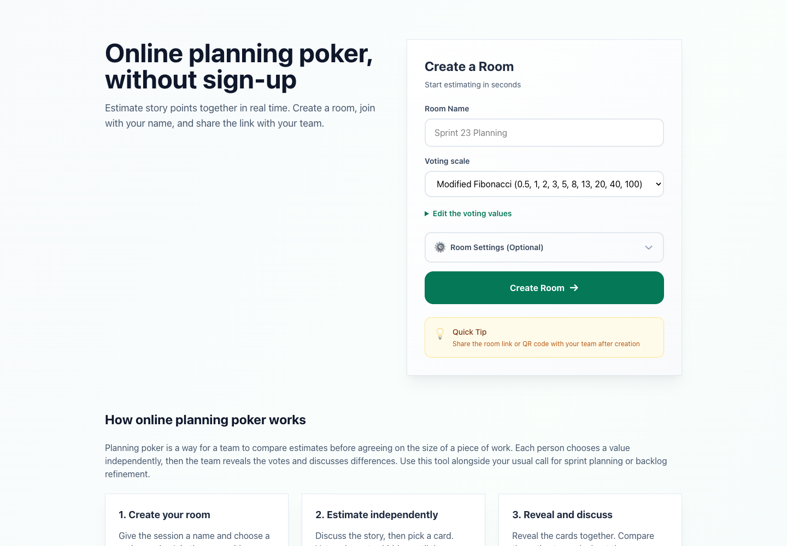

I built [pokerplanning.net](https://pokerplanning.net/) for a fairly specific job: run a planning poker session in a browser without asking the whole team to create another account. Create a room, join with your name, share the link, vote, reveal, discuss. That was the useful part.

Then I gave it a Go backend, a WebSocket hub and a deployment pipeline involving Terraform and AWS Systems Manager. I may have enjoyed the infrastructure part a little too much.

The app is available to use now. This is the story behind it, and how to run a session if the tool is the part you're interested in.

## Run a Planning Poker Session Without Registering

Planning poker combines individual estimates with a team discussion. Everyone picks a value before the cards are revealed, then the team talks about the differences. [Mountain Goat Software's guide](https://www.mountaingoatsoftware.com/agile/story-points/planning-poker) explains the method; the app handles the shared room and voting.

The workflow is short:

1. **Create a room.** Give it a name and choose Fibonacci, modified Fibonacci, t-shirt sizes or your own values.
2. **Join it yourself**, then share the room link or QR code. Teammates enter a display name and choose whether to vote or spectate.
3. **Discuss one story and vote.** The room shows who has voted while keeping the values hidden until reveal.
4. **Reveal and compare.** Review the distribution, agreement and, for numeric votes, the average. Talk through the differences rather than treating the average as the team's decision.
5. **Vote again or start the next round.** Room settings control who can reveal, reset and advance, and whether reveal happens automatically once everyone has voted.

Rooms expire 24 hours after creation. They're temporary spaces for a session, not a permanent backlog or a record of every estimate your team has ever made. Keep your usual issue tracker and call alongside the room.

## Why I Started with PocketBase

I spent years doing WordPress development. One thing I appreciated was having a usable starting point: data, administration and conventions already there. When I moved further into Go, I didn't particularly want every side project to begin with choosing an ORM, wiring authentication and building an admin interface.

[PocketBase](https://pocketbase.io/docs/) gave me a similar baseline in Go: SQLite, collections, migrations, authentication capabilities and an admin UI. The public planning poker flow doesn't require an account, but I still wanted the backend's data-management tools.

That let me spend time on rooms, participants, rounds and votes. Those are the things the app actually needs to understand. Choosing a backend that already handles the surrounding plumbing was a way to get to them sooner.

## SQLite for the Votes, WebSockets for the Room

The persistent state lives in SQLite through PocketBase. A room has participants and rounds; votes belong to a round. The live connections are managed separately by the Go WebSocket hub.

That keeps storage and delivery separate. The hub tracks active room membership and broadcasts updates. Bounded queues and connection limits put safeguards around the workload, while the database keeps the session data.

For this project, the practical advantage of SQLite is simpler: no separate database service to operate for a tool with a small, defined data model.

## htmx Instead of a Separate Frontend App

The interface is rendered with [templ](https://templ.guide/) in Go. [htmx](https://htmx.org/docs/) handles the HTML interactions and WebSocket integration; Alpine.js handles browser-side controls such as the room settings.

I like keeping the interface close to the server for this kind of app. A room isn't a whole frontend platform. It needs to show participants, accept votes, reveal results and stay in step with the server's current round.

The interesting part is the round lifecycle: `voting → revealed → completed`. When someone reconnects or another participant starts the next round, the browsers need to converge on the same state. There are integration tests around voting, automatic reveal and participant limits, plus concurrency tests around the hub.

That is where the care belongs. A tidy form doesn't help if two people are looking at different rounds.

## The Deployment Rabbit Hole

The original deployment workflow was more elaborate than the form suggested. A version tag triggered tests, a Docker image build and a push to GitHub Container Registry. GitHub Actions then used AWS Systems Manager to run the deployment command on EC2.

Production has since moved to AWS Lightsail. The current pipeline still tests and builds the app from a version tag, then deploys the container using a short-lived Lightsail SSH certificate and checks the public health endpoint. Terraform describes the infrastructure, and Docker Compose runs the service.

The mechanism changed, but the goal stayed the same: a repeatable release that checks what actually happened, rather than assuming an uploaded image means the app is live.

Could I have kept this smaller? Certainly. But I wanted to work through a repeatable Go deployment that doesn't depend on manually opening an SSH session. The pipeline was part of what I wanted to learn, even if a planning poker room hardly demanded the whole exercise.

## Use the Tool, or Read the Code

If your team needs an online planning poker room without registration, [create a room on pokerplanning.net](https://pokerplanning.net/). Choose your scale, join first and send the link to the team.

The [code is on GitHub](https://github.com/damione1/planning-poker), under the [Elastic License 2.0](https://github.com/damione1/planning-poker/blob/master/LICENSE). If you're here for the implementation, the room manager, WebSocket hub and integration tests are the useful places to start.

It's a small collaboration tool built around a deliberately short user journey. The deployment took the scenic route. Joining a room shouldn't have to.
