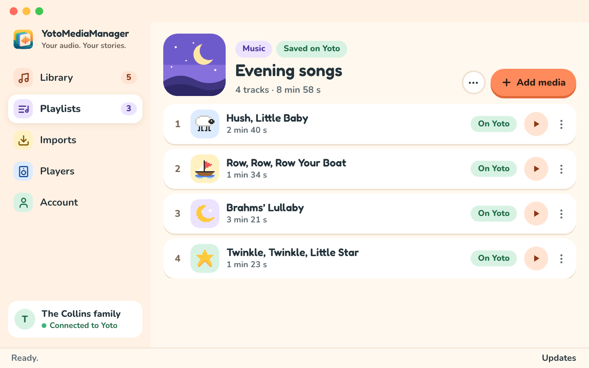

My toddler has a very precise taste in music: a handful of nursery rhymes, on repeat. We have a Yoto at home, and I wanted those songs coming out of it. The exact versions. Anyone with a toddler will understand why the exact versions matter.

The versions we liked were on YouTube. Much of the other content I was finding was in English or aimed at older children. Yoto has a wonderful catalogue, but my kid's wish list was considerably shorter and more specific.

Thankfully, Yoto lets families bring their own audio through Make Your Own cards, and provides an [API for developers](https://yoto.dev/). I'm grateful they left that door open.

So I built [YotoMediaManager](https://yotomediamanager.app/), a free desktop app for macOS and Windows that brings the audio preparation and playlist editing into one place.

## From a Link to a Playlist

Import an audio file or paste a YouTube link. For a public YouTube playlist, choose which videos you want. Then prepare the audio and add it to a playlist on your Yoto account.

Your library and audio preparation stay on your computer. The selected audio goes to Yoto when you add it to a playlist. To link that playlist to a physical Make Your Own card, you still use the official Yoto app on your phone. The [getting-started guide](https://yotomediamanager.app/docs/getting-started/) covers that last step.

## Keep the Song, Cut the Rest

A music video can have an introduction, a long silence, or credits you don't want to hear every time. Drag the start and end handles on the waveform, preview the selection, and keep just the song. You can also enter the positions directly for a more precise cut.

The original stays untouched. You can prepare different versions of the same audio, level the volume between songs, and choose the little pixel icons that appear on the player. Those icons are useful when the person choosing the next song can't read yet.

## Give Long Recordings Chapters

For an audiobook, a long story, or several songs in one recording, you can place chapter markers on the waveform and name each part. Move a marker if the cut isn't quite right. When you add the recording to a playlist, those parts become separate tracks, so the Yoto's buttons can skip between them.

No separate audio editor, and no need to cut the original into a pile of files yourself.

## Keeping Up with YouTube

The YouTube imports rely on [yt-dlp](https://github.com/yt-dlp/yt-dlp). YouTube changes, and the downloader sometimes needs an update to catch up.

So yt-dlp can update independently of YotoMediaManager. The app checks for newer releases, including when an import fails because YouTube changed. When an upstream fix is available, it can update the downloader without me having to build and distribute a whole new app. One dependency worth keeping separate.

## Try It

YotoMediaManager is free and open source, under GPL-3.0-or-later, with an English and French interface. It's an independent project built on Yoto's API.

You can [download it for Mac or Windows](https://yotomediamanager.app/#download), or look through the [source on GitHub](https://github.com/damione1/yoto-media-manager). If you try it with your family's playlists, feedback and bug reports are welcome.
