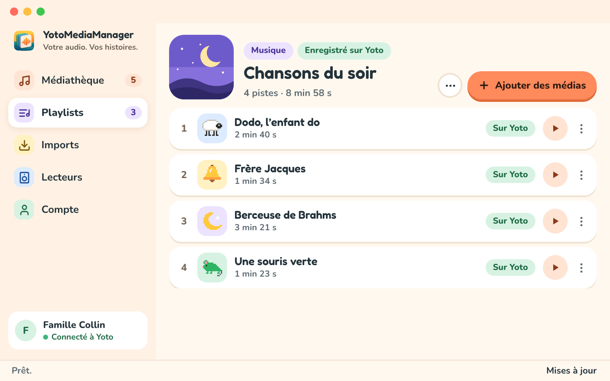

Mon enfant a des goûts musicaux très précis : une poignée de comptines, en boucle. On a un Yoto à la maison, et je voulais que ces chansons en sortent. Les bonnes versions. Les parents de jeunes enfants comprendront pourquoi les bonnes versions comptent.

Celles qu’on aimait étaient sur YouTube. Une bonne partie du reste de ce que je trouvais était en anglais ou destiné à des enfants plus grands. Yoto a un très beau catalogue, mais la liste des envies de mon enfant était nettement plus courte et plus précise.

Heureusement, Yoto permet aux familles d’ajouter leur propre audio avec les cartes Make Your Own, et met une [API à disposition des développeurs](https://yoto.dev/). Je leur suis reconnaissant d’avoir laissé cette porte ouverte.

J’ai donc créé [YotoMediaManager](https://yotomediamanager.app/fr/), une app gratuite pour macOS et Windows qui regroupe la préparation de l’audio et l’édition des playlists.

## D’un lien à une playlist

On importe un fichier audio ou on colle un lien YouTube. Pour une playlist YouTube publique, on choisit les vidéos à garder. Ensuite, on prépare l’audio et on l’ajoute à une playlist sur son compte Yoto.

La médiathèque et la préparation de l’audio restent sur l’ordinateur. L’audio sélectionné part chez Yoto quand on l’ajoute à une playlist. Pour associer cette playlist à une carte Make Your Own physique, on passe encore par l’app officielle Yoto sur le téléphone. Le [guide de démarrage](https://yotomediamanager.app/fr/docs/getting-started/) explique cette dernière étape.

## Garder la chanson, couper le reste

Un clip peut avoir une introduction, un long silence ou un générique qu’on n’a pas envie de réécouter à chaque fois. On déplace les poignées de début et de fin sur la forme d’onde, on écoute la sélection et on garde juste la chanson. On peut aussi saisir les positions directement pour une découpe plus précise.

L’original reste intact. On peut préparer plusieurs versions du même audio, égaliser le volume entre les chansons et choisir les petites icônes qui s’affichent sur le lecteur. Ces icônes sont bien utiles quand la personne qui choisit la chanson suivante ne sait pas encore lire.

## Découper les longs enregistrements en chapitres

Pour un livre audio, une longue histoire ou plusieurs chansons réunies dans un même enregistrement, on peut placer des repères de chapitres sur la forme d’onde et nommer chaque partie. Si la coupe tombe mal, on déplace le repère. Quand on ajoute l’enregistrement à une playlist, ces parties deviennent des pistes séparées : les boutons du Yoto permettent de passer de l’une à l’autre.

Pas besoin d’un éditeur audio à côté, ni de découper soi-même l’original en une pile de fichiers.

## Suivre les changements de YouTube

Les imports YouTube reposent sur [yt-dlp](https://github.com/yt-dlp/yt-dlp). YouTube change, et l’outil de téléchargement a parfois besoin d’une mise à jour pour suivre.

yt-dlp peut donc se mettre à jour indépendamment de YotoMediaManager. L’app cherche les nouvelles versions, notamment lorsqu’un import échoue à cause d’un changement côté YouTube. Quand un correctif est disponible en amont, elle peut mettre à jour l’outil sans que j’aie à reconstruire et redistribuer toute l’app. Une dépendance qui mérite de garder son propre rythme.

## Essayer l’app

YotoMediaManager est gratuit et open source, sous licence GPL-3.0-or-later, avec une interface en français et en anglais. C’est un projet indépendant qui utilise l’API de Yoto.

Vous pouvez [le télécharger pour Mac ou Windows](https://yotomediamanager.app/fr/#download), ou consulter le [code sur GitHub](https://github.com/damione1/yoto-media-manager). Si vous l’essayez avec les playlists de votre famille, les retours et les signalements de bugs sont les bienvenus.
